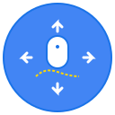

# 🖱️ BA Mouse Gesture

<div align="center">



**シンプルで強力なマウスジェスチャーツール for Chrome**

[](https://github.com/ba0918/ba-mouse-gesture/actions)
[](https://github.com/ba0918/ba-mouse-gesture)
[](https://chrome.google.com/webstore)
[](security-checklist.md)
[](LICENSE)

---

🎯 **マウスジェスチャーでブラウジングを高速化**  
🧠 **AI学習機能で個人最適化**  
🔒 **完全オフライン・セキュア**  
⚡ **軽量・高性能（0.06MB）**

</div>

## ✨ 特徴

### 🚀 基本機能
- **7種類のジェスチャー**: 左右上下 + 複合ジェスチャー（↓→、↑→、→↓、↑↓）
- **リアルタイム軌跡表示**: ジェスチャー中に美しい軌跡を表示
- **感度カスタマイズ**: 5-50pxの範囲で個人の使い方に最適化
- **除外サイト機能**: 特定サイトでの無効化設定

### 🧠 AI学習機能
- **適応的パターン認識**: 使用パターンを学習して精度向上
- **動的閾値調整**: 成功率に基づく自動最適化
- **個人特徴学習**: ユーザー固有のジェスチャー癖を識別
- **学習統計表示**: 成功率・使用頻度・最適化状況の可視化

### 🎨 カスタマイズ
- **カスタムジェスチャー**: 独自パターンの作成・管理
- **軌跡スタイル**: 色・太さの自由設定
- **詳細設定**: デバッグモード・ログレベル制御

### 🔒 セキュリティ・品質
- **完全オフライン動作**: 外部通信なし
- **最小権限設計**: 必要最小限のブラウザ権限
- **141テスト全パス**: 包括的品質保証
- **セキュリティ監査済み**: XSS対策・CSP準拠

## 📊 対応ジェスチャー

| ジェスチャー | アクション | 説明 |
|------------|-----------|------|
| **← (左)** | ブラウザの戻る | 前のページに戻る |
| **→ (右)** | ブラウザの進む | 次のページに進む |
| **↑ (上)** | ページトップへ | ページの最上部にスクロール |
| **↓ (下)** | ページボトムへ | ページの最下部にスクロール |
| **↓→ (下→右)** | タブを閉じる | 現在のタブを閉じる |
| **↑→ (上→右)** | 新しいタブ | 新しいタブを開く |
| **→↓ (右→下)** | タブ複製 | 現在のタブを複製 |
| **↑↓ (上→下)** | ページ更新 | ページをリロード |

## 🚀 インストール方法

### Chrome Web Store（推奨）
1. [Chrome Web Store](https://chrome.google.com/webstore) にアクセス
2. "BA Mouse Gesture" を検索
3. 「Chromeに追加」をクリック

### 開発版インストール
1. このリポジトリをクローン
   ```bash
   git clone https://github.com/ba0918/ba-mouse-gesture.git
   cd ba-mouse-gesture
   ```

2. 依存関係をインストール
   ```bash
   pnpm install
   ```

3. 拡張機能をビルド
   ```bash
   pnpm build
   ```

4. Chromeで開発者モードを有効化
   - `chrome://extensions/` を開く
   - 右上の「デベロッパーモード」をオン

5. 拡張機能を読み込み
   - 「パッケージ化されていない拡張機能を読み込む」をクリック
   - `dist/` フォルダを選択

## 📖 使用方法

### 基本操作
1. **右クリック + マウス移動** でジェスチャー開始
2. **マウスを離す** でジェスチャー実行
3. **リアルタイム軌跡** で現在の動きを確認

### 設定画面
1. 拡張機能アイコンをクリック
2. 「オプション」を選択
3. 各種設定をカスタマイズ

### カスタムジェスチャー作成
1. オプション画面の「カスタムジェスチャー」セクション
2. 「新規作成」ボタンをクリック
3. パターンを描画してアクションを設定
4. 保存して有効化

### AI学習機能の活用
- **自動学習**: 使用するほど認識精度が向上
- **学習統計**: オプション画面で成功率・使用頻度を確認
- **個人最適化**: 使い込むほどあなた専用に最適化

## 🛠️ 開発

### 環境要件
- Node.js 18.x 以上
- pnpm 8.x 以上

### 開発コマンド
```bash
# 依存関係インストール
pnpm install

# 開発ビルド（ファイル監視）
pnpm build:watch

# テスト実行
pnpm test              # 単体テスト
pnpm test:e2e         # E2Eテスト
pnpm test:coverage    # カバレッジ付きテスト

# 品質チェック
pnpm lint             # ESLint実行
pnpm lint:fix         # 自動修正付きESLint

# 本番ビルド
pnpm build            # 最適化ビルド
```

### プロジェクト構造
```
ba-mouse-gesture/
├── content_scripts/          # Webページに注入されるスクリプト
├── background/              # バックグラウンドスクリプト
├── popup/                   # 設定画面（options.html/js）
├── assets/                  # アイコン等の静的ファイル
├── tests/                   # テストスイート
│   ├── unit/               # 単体テスト
│   ├── integration/        # 統合テスト
│   ├── e2e/               # E2Eテスト
│   └── performance/       # パフォーマンステスト
├── .github/workflows/      # CI/CD設定
└── dist/                   # ビルド出力
```

### 品質保証
- **141テスト全パス**: 単体・統合・E2E・パフォーマンステスト
- **CI/CD自動化**: GitHub Actions による継続的品質管理
- **Pre-commit Hook**: コミット時の自動品質チェック
- **セキュリティ監査**: 定期的なセキュリティチェック

## 📈 技術スタック

### コア技術
- **VanillaJS**: フレームワーク依存なし、軽量性重視
- **Chrome Extension Manifest V3**: 最新セキュリティ標準準拠
- **Canvas API**: 高性能な軌跡描画

### 開発・品質管理
- **TypeScript**: 型安全性（推奨時）
- **Jest**: 単体・統合テスト
- **Playwright**: E2Eテスト
- **ESLint**: 静的解析
- **esbuild**: 高速ビルド（99.9%サイズ削減）

### AI・アルゴリズム
- **Levenshtein距離**: パターンマッチング
- **LCS（最長共通部分列）**: 軌跡類似度判定
- **動的閾値調整**: 機械学習ベース最適化

## 🤝 貢献

### 貢献方法
1. このリポジトリをフォーク
2. feature/ブランチを作成
3. 変更を実装（TDD推奨）
4. テストを追加・実行
5. プルリクエストを作成

### 開発ガイドライン
- **TDD実践**: テストファースト開発
- **コミット規約**: [Conventional Commits](https://www.conventionalcommits.org/)
- **品質ゲート**: pre-commit/pre-pushフック実行
- **コードレビュー**: プルリクエスト必須

## 📜 ライセンス

MIT License - 詳細は [LICENSE](LICENSE) ファイルを参照

## 🙏 謝辞

このプロジェクトは以下の技術・コミュニティに支えられています：
- Chrome Extensions API
- Jest & Playwright Testing Framework
- GitHub Actions CI/CD
- Open Source Community

---

<div align="center">

**🖱️ より快適なブラウジング体験を**

[インストール](https://chrome.google.com/webstore) | [ドキュメント](https://github.com/ba0918/ba-mouse-gesture) | [問題報告](https://github.com/ba0918/ba-mouse-gesture/issues)

</div>